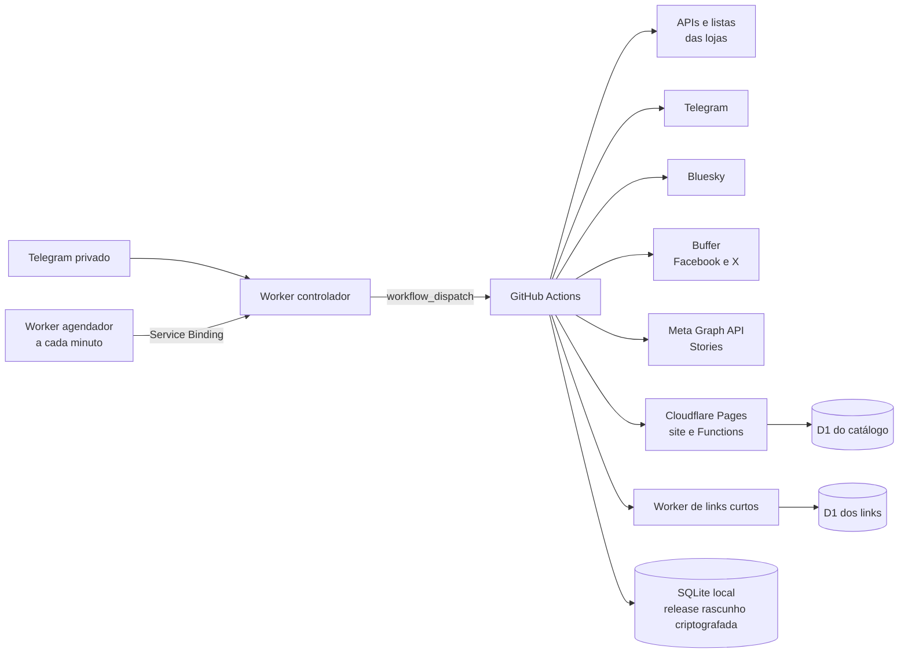

# Canal Tá Barato — contexto completo do projeto

> Documento de continuidade para humanos e assistentes de IA.
>
> Última revisão: **17/09/2026**, fuso `America/Sao_Paulo`.
>
> Este arquivo não contém valores de tokens, senhas, chaves privadas ou IDs
> administrativos. Nunca inclua esses valores aqui.

## 1. Resumo executivo

O Canal Tá Barato é um sistema de curadoria e publicação automática de ofertas.
Ele busca ou importa produtos de fontes autorizadas, confirma se a oferta ainda
está vigente, classifica os candidatos, cria links de afiliado/rastreamento e
publica a mesma oferta com formato adequado em:

- Telegram;
- Bluesky;
- Facebook;
- X;
- Instagram Stories;
- site próprio em `https://canaltabarato.com.br`.

O projeto também inclui:

- catálogo próprio de ofertas e cupons;
- links curtos em `https://go.canaltabarato.com.br`;
- revalidação gradual de preço e disponibilidade;
- resposta automática opcional no Direct do Instagram;
- painel privado no Telegram;
- agendamento econômico por Cloudflare Workers;
- histórico persistente e criptografado entre execuções do GitHub Actions;
- relatórios agregados de publicações, cliques, conversões e saúde dos canais;
- proteções contra duplicação, abuso, SSRF e vazamento de segredos.

O sistema é propositalmente simples para o operador: no Mercado Livre e na
Amazon, adicionar um produto à lista pública de curadoria já o coloca na fila do
bot. Shopee e AliExpress são abastecidos pelas APIs dos programas de afiliados.

## 2. Fonte de verdade e estado do repositório

Este documento deve ser o primeiro arquivo lido por uma pessoa ou IA que assumir
o projeto. O código é a fonte de verdade final. Alguns documentos mais antigos,
especialmente `PROXIMOS-PASSOS.md`, descrevem etapas que já foram concluídas e
podem estar desatualizados.

Para conferir o estado atual, consulte `git status`, `git log -1` e
`git fetch origin main` antes de comparar com `origin/main`. Não considere um
hash registrado neste documento como estado atual do código ou da produção.
Preserve e revise qualquer alteração local antes de atualizar a branch.

O relatório original da auditoria está em
`docs/security-audit/relatorio-auditoria-seguranca.pdf`. O acompanhamento das
correções está em `docs/security-audit/remediacao.md` e os controles externos
pendentes estão em `docs/security-audit/controles-externos.md`.

## 3. Identidade pública do projeto

| Canal | Endereço público |
| --- | --- |
| Site | `https://canaltabarato.com.br/` |
| Links curtos | `https://go.canaltabarato.com.br/` |
| Telegram | `https://t.me/CanalTaBarato` |
| Instagram | `https://www.instagram.com/ofertascanaltabarato/` |
| Facebook | `https://facebook.com/canaltabarato` |
| X | `https://x.com/canaltabarato` |
| Bluesky | `https://bsky.app/profile/canaltabarato.com.br` |

Ativos visuais principais:

- `assets/canal-ta-barato-logo.jpg`;
- `assets/canal-ta-barato-capa-redes.png`;
- `assets/canal-ta-barato-social-promo.png`;
- `marketing/campanha-seguidores-facebook.png`.

## 4. Arquitetura



### Componentes

1. **Bot em Python**
   - Busca, normaliza, filtra, classifica e publica ofertas.
   - Arquivo principal: `main.py`.
   - Configuração: `config.py` e variáveis de ambiente.

2. **GitHub Actions**
   - `.github/workflows/bot.yml`: execução real do bot.
   - `.github/workflows/ci.yml`: testes Python e JavaScript.
   - `.github/workflows/monitor.yml`: monitor diário e alertas.

3. **Painel privado e agendador Cloudflare**
   - `telegram-control/`: recebe somente comandos do administrador.
   - `telegram-control/scheduler/`: cron isolado, sem credenciais do GitHub ou
     Telegram; aciona o controlador por Service Binding.

4. **Site Cloudflare Pages**
   - frontend estático em `site/public/`;
   - backend em `site/functions/`;
   - catálogo e métricas agregadas em Cloudflare D1;
   - schema base em `site/schema.sql` e evoluções em `site/migrations/`.

5. **Redirecionador Cloudflare Worker**
   - código em `redirector/`;
   - domínio `go.canaltabarato.com.br`;
   - links e cliques agregados em outro banco D1.

6. **Estado operacional do bot**
   - SQLite local `postadas.db` durante a execução;
   - enviado de forma compactada e criptografada a uma release rascunho técnica;
   - criptografia autenticada usando `BOT_STATE_KEY`;
   - gravação atômica por manifesto, restauração e validação em `estado_remoto.py`;
   - não consome o limite de Actions Storage.

Não há cadastro de usuários, login público, organizações ou multi-tenancy. O
site é uma vitrine pública; escritas administrativas exigem tokens de serviço.

## 5. Fluxo completo de uma rodada

1. O scheduler consulta o relógio uma vez por minuto.
2. Quando o intervalo do modo selecionado vence, o controlador dispara o
   workflow `Bot de Ofertas` na branch `main`.
3. O workflow instala as dependências e restaura o SQLite criptografado.
4. Shopee, AliExpress, Amazon e Mercado Livre são consultados em paralelo,
   desde que estejam ativos e configurados.
5. Cada fonte devolve ofertas no mesmo formato interno.
6. O bot aplica filtros de qualidade, limites diários, proteção contra produto
   semelhante, histórico de publicação e diversidade.
7. Os candidatos de todas as lojas entram em uma fila global.
8. A fila é ordenada por qualidade da oferta, desconto, comissão, desempenho
   histórico, preferência configurada da loja e sinais de curadoria.
9. Amazon e Mercado Livre são consultados outra vez imediatamente antes da
   publicação. O bot atualiza preço e dados; se o produto saiu da lista ou não
   atende mais aos filtros, ele não é publicado.
10. Para cada canal ainda pendente, o bot gera um link rastreado específico,
    tenta encurtá-lo e publica no formato daquele canal.
11. Cada entrega é gravada separadamente. Se X falhar e os demais funcionarem,
    a próxima tentativa pula os canais já concluídos e tenta apenas X.
12. O site recebe um `upsert` idempotente da oferta selecionada. Em uma nova
    rodada ele pode atualizar novamente a data e os dados do item sem duplicar
    o registro.
13. Cupons oficiais, atalhos de loja, catálogo antigo e relatório também são
    atualizados quando aplicável.
14. O SQLite é limpo, compactado antes da criptografia e salvo como asset de uma
    release rascunho. O manifesto só aponta para o snapshot novo depois que o
    upload termina; assets antigos são removidos em seguida.

Uma falha de um canal não desfaz os sucessos dos outros canais. Falhas de
transporte sem confirmação não são repetidas dentro da mesma chamada quando
isso poderia criar uma publicação duplicada.

## 6. Fontes de ofertas

| Fonte | Entrada | Situação | Validação e link |
| --- | --- | --- | --- |
| Shopee | API oficial de afiliados | Implementada | Busca listas padrão e mais vendidos, consulta campanhas/cupons e gera link com `subid`. |
| AliExpress | API de afiliados | Implementada | Busca, normaliza, gera link com tracking por canal e usa relatório de conversões. |
| Amazon | Lista pública de curadoria e, opcionalmente, Creators API | Implementada | Aceita apenas tags de origem autorizadas e publica com a tag do bot; revalida a lista antes do post. |
| Mercado Livre | Lista pública de recomendações | Implementada | Preserva o link rastreado da própria lista e revalida preço/vigência antes do post. |
| Magalu | Nenhuma integração disponível no projeto | Não implementada | Só deve ser adicionada com fonte e método de afiliação autorizados. |

### Amazon

- Lista de ofertas escolhida pelo operador: `https://www.amazon.com.br/shop/emersonpettor/list/2ZUSMM2BR8LVZ?ref_=aipsflist`.
- Tag configurada no workflow: `canaltabarato-20`.
- A vitrine `https://www.amazon.com.br/shop/emersonpettor/list/2ZUSMM2BR8LVZ?ref_=aipsflist`
  usa `emersonpettor-20`, outro ID de rastreamento da mesma conta confirmado pelo
  operador. O workflow autoriza esse ID como origem via `AMAZON_LIST_SOURCE_TAGS`;
  os links publicados recebem `canaltabarato-20`.
- A URL da lista ativa ainda é controlada pela variável `AMAZON_LIST_URL` do
  GitHub Actions; autorizar a tag não muda automaticamente qual lista é lida.
- Tudo que o operador adiciona à lista pública pode entrar na fila.
- A importação rejeita cartões incompletos, links sem uma tag de origem autorizada,
  ASIN inválido, imagem fora dos hosts oficiais ou preço ausente.
- Se as credenciais da Creators API estiverem presentes, o projeto também pode
  pesquisar e consultar produtos pela API.
- `AMAZON_ATIVA` controla a fonte sem apagar a configuração.
- Quando a lista está configurada, o atalho com ícone da Amazon no site leva
  à própria lista curada; não tenta gerar um link afiliado para a home genérica.

### Mercado Livre

- Lista atualmente usada: `https://meli.la/2nNpgzg`.
- Tudo que o operador adiciona à lista pública pode entrar na fila.
- O link capturado no cartão da lista é preservado, incluindo o rastreamento de
  afiliado fornecido pelo Mercado Livre.
- A importação percorre as páginas da lista (não apenas a primeira), com limite
  de 20 páginas e `MERCADOLIVRE_FETCH_LIMIT` produtos.
- O produto precisa continuar presente na lista no instante anterior ao post.
- A opção `somente_pendentes` do workflow do bot compara ambas as listas com o
  estado remoto de publicações e gera um relatório sem publicar ofertas.
- O link do Mercado Livre no Story, Bluesky e X precisa obrigatoriamente passar
  pelo domínio próprio. Se o encurtador falhar, esses canais são marcados como
  falha em vez de expor a URL longa.
- O site **não mostra um atalho genérico direto para a loja Mercado Livre**;
  somente ofertas individuais podem apontar para produtos da plataforma.

### Curadoria manual simples

O fluxo desejado é:

1. abrir a lista pública da Amazon ou Mercado Livre no navegador/celular;
2. adicionar os produtos considerados interessantes;
3. não copiar links para planilhas nem enviar comandos extras;
4. aguardar a próxima rodada;
5. o bot importa a lista, aplica os filtros compatíveis e publica aos poucos.

O projeto não importa ofertas copiadas de outros canais do Telegram. Essa opção
foi discutida, mas o fluxo por listas públicas oficiais é mais simples,
rastreável e menos sujeito a links de terceiros ou ofertas vencidas.

## 7. Seleção, filtros e repetição

Filtros centrais:

- desconto mínimo (`MIN_DISCOUNT`);
- avaliação mínima (`MIN_RATING`);
- vendas mínimas (`MIN_SALES`);
- preço mínimo (`MIN_PRICE`);
- ganho mínimo estimado por venda (`MIN_GANHO`);
- desconto preferido e exceção para produtos muito vendidos;
- limite total diário e limite por loja;
- proteção contra títulos/produtos semelhantes;
- diversidade entre as últimas publicações;
- horário permitido e horários de pico.

Listas de curadoria manual podem não fornecer vendas ou comissão. Nesses casos,
o próprio ato de incluir o item na lista é o sinal de curadoria e os campos
ausentes não são inventados.

Regras padrão de repetição:

- o mesmo produto não é publicado duas vezes no mesmo dia;
- normalmente só volta depois de 7 dias;
- pode voltar antes se o preço cair pelo menos 15% em relação à última
  publicação;
- produtos semelhantes ficam bloqueados por uma janela própria;
- a entrega é controlada por produto **e por canal**.

A pontuação considera desconto, comissão estimada, preferência moderada da
fonte, histórico recente de conversão/comissão, cancelamentos, categoria,
popularidade e diversidade. Há teste A/B rastreável entre chamada humana e
abertura objetiva.

## 8. Canais e comportamento de publicação

### Telegram

- Integração direta pela Bot API.
- Publica foto, legenda HTML e botão “Ver oferta”.
- Se a foto falhar, tenta uma mensagem de texto com o mesmo link.
- Também recebe bom-dia, cupons, Shopee VIP e relatório privado.

### Bluesky

- Integração direta pelo AT Protocol.
- Texto e facets são ajustados ao limite da rede.
- Imagens só são baixadas de hosts oficiais permitidos.
- Se a imagem não puder ser validada, a publicação pode seguir sem ela e o
  fallback é contabilizado.

### Facebook

- Caminho preferido: canal conectado no Buffer.
- Alternativa: Graph API direta da Página, somente quando o Buffer não está
  configurado.
- No caminho direto, a imagem é primeiro enviada como não publicada e depois
  anexada a um `feed post`. Isso evita que a oferta apareça apenas na aba
  “Fotos” em vez da aba principal da Página.
- Se o Buffer respondeu com falha ou houve transporte sem confirmação, o bot
  não muda para Graph API na mesma tentativa, pois isso poderia duplicar o post.
- O card é 1080 × 1350 (4:5), com título completo ajustado ao espaço, sem
  reticências artificiais no final.

### X

- Publicação por canal conectado no Buffer.
- Limite rígido de 280 caracteres.
- O texto remove elementos opcionais progressivamente, corta apenas em limite
  de palavra e nunca acrescenta reticências ao título.
- O card 4:5 é o mesmo padrão visual do Facebook.

### Instagram Stories

- Publicação pela Meta Graph API em conta profissional ligada à Página.
- O card é 1080 × 1920 (9:16).
- O layout calcula dinamicamente título, preço, desconto e painel inferior;
  títulos com quatro linhas ou mais não sobrepõem o preço.
- A API não permite ao projeto criar Link Sticker. Por isso o endereço curto
  exato aparece escrito no cartão.
- O JPEG é hospedado temporariamente pelo site, validado e então buscado pela
  Meta.
- Uma falha após `media_publish` não é repetida automaticamente para evitar um
  Story duplicado.

### Site

- Não está dentro de `CANAIS` porque possui fluxo próprio, mas recebe toda
  oferta selecionada quando `SITE_ATIVO=true`.
- O endpoint de publicação faz `upsert` e preserva o catálogo.
- Uma falha do site não impede a publicação nas redes sociais.

## 9. Padrão das legendas e publicidade

Todas as redes usam a mesma identidade editorial, adaptada aos limites de cada
plataforma:

- título limpo e direto, sem chamada humana;
- preço atual e, quando confiável, preço anterior;
- nota, vendas e nome do vendedor quando disponíveis;
- cupom e condição quando oficiais;
- ação de compra/resgate com nome da plataforma;
- identificação `#ad` na mesma linha do link em todas as lojas.

O Telegram risca o preço anterior e destaca o atual em negrito. Facebook,
Bluesky e X usam texto simples; Bluesky e X preservam preço e link e encurtam
primeiro os detalhes opcionais para respeitar seus limites de caracteres.

A frase longa “link de afiliado” foi removida das ofertas sociais. O site
mantém seus próprios avisos de transparência e termos. Não
remover toda identificação publicitária sem uma revisão jurídica/comercial.

Preços, estoque e condições podem mudar depois do post. Amazon e Mercado Livre
são revalidados imediatamente antes da publicação; o catálogo do site é
revisado gradualmente nas rodadas seguintes.

## 10. Links de afiliado e redirecionamento

O bot primeiro pede à fonte um link afiliado específico para o canal e depois
tenta criar um link próprio.

O redirecionador:

- cria um slug curto;
- guarda destino, oferta, canal, fonte e data;
- registra somente contagens agregadas de cliques;
- não armazena IP, comprador, pedido ou dado pessoal em claro;
- usa HMAC temporário para deduplicação;
- aplica rate limit no edge quando o binding está configurado;
- aceita somente destinos HTTPS em hosts permitidos.

Hosts atualmente permitidos incluem domínios oficiais de Shopee, AliExpress,
Amazon e Mercado Livre. A allowlist precisa continuar sincronizada entre:

- `redirector/wrangler.jsonc`;
- `redirector/wrangler.toml.example`;
- `site/wrangler.toml.example`;
- validações do código e respectivos testes.

Fallback normal: se o serviço de links curtos falhar, o bot usa o link oficial
de afiliado. Exceção: Mercado Livre em Bluesky, X e Instagram Stories exige o
link próprio por legibilidade e consistência.

## 11. Site e catálogo

O site é uma vitrine mobile-first em Cloudflare Pages. Recursos principais:

- feed paginado de ofertas;
- pesquisa por título;
- filtros de plataforma, categoria, faixa de preço, nota, loja, período e cupom;
- ordenação por em alta, recentes, desconto, vendas e preço;
- páginas individuais de produto;
- histórico diário de preços observados;
- ofertas relacionadas;
- favoritos apenas no navegador;
- compartilhamento;
- aviso de preço alterado;
- relatos de problemas com rate limit e deduplicação;
- páginas de cupons;
- atalhos somente para lojas com link afiliado válido;
- sitemap dinâmico, canonical, Open Graph, Schema.org, `robots.txt` e `llms.txt`;
- páginas fixas de descoberta;
- IndexNow em segundo plano;
- métricas agregadas de visitas, origem de tráfego e cliques de saída.

Revalidação do catálogo:

- a cada rodada o bot solicita até `SITE_REFRESH_PER_RUN` candidatos;
- itens recentes e clicados têm prioridade;
- a fonte consulta novamente os produtos;
- uma falha externa adia a decisão;
- um produto só fica indisponível depois de consultas válidas sem resultado,
  conforme a regra do backend;
- atualizar o catálogo não cria novo post nas redes.

O D1 do site armazena ofertas, histórico de preços, cupons, links de loja,
cliques agregados, visitas agregadas, feedback agregado, ativos temporários de
Story, associação Story/oferta, eventos deduplicados do Direct e controles de
abuso. Não armazena contas de clientes.

## 12. Resposta automática no Direct do Instagram

Quando habilitada:

- qualquer resposta a um Story usa a oferta associada àquele Story;
- uma mensagem comum contendo `QUERO` usa o Story/oferta mais recente;
- o webhook valida assinatura da Meta;
- o evento é deduplicado para não responder duas vezes;
- a resposta é curta e amigável, com título, preço quando disponível e link;
- o bot tenta garantir a inscrição da Página nos campos de mensagens;
- falhar ao registrar o Direct não repete nem desfaz um Story já publicado.

Endpoint: `https://canaltabarato.com.br/api/meta-webhook`.

Permissões normalmente necessárias: `instagram_manage_messages`,
`pages_manage_metadata` e, quando exigido, `pages_messaging`. O funcionamento
para o público depende também do nível de acesso aprovado no aplicativo Meta;
isso não pode ser comprovado apenas pelo repositório.

Enquanto `INSTAGRAM_DIRECT_ATIVO=false`, o cartão não deve prometer resposta
automática; ele mostra a instrução para acessar/digitar o link.

## 13. Painel privado do Telegram

O painel em `telegram-control/` permite:

- ver status;
- executar uma rodada manual com confirmação;
- selecionar modo Econômico, Normal, Rápido ou Pausado;
- solicitar relatório;
- habilitar/desabilitar fontes e canais permitidos;
- ajustar pesos, filtros, horários, variedade, limites e alertas;
- consultar o histórico das últimas mudanças;
- restaurar padrões sem apagar credenciais.

Comandos principais: `/painel`, `/status`, `/executar`, `/ritmo`, `/pausar`,
`/retomar`, `/relatorio`, `/config`, `/historico` e `/definir`.

Proteções:

- secret do webhook do Telegram;
- administrador e conversa privada precisam coincidir;
- corpo limitado;
- nomes de variável em allowlist;
- valores dentro de faixas seguras;
- confirmação para mudanças e publicação manual;
- não permite editar tokens, destinos ou chaves de criptografia;
- o token do GitHub deve ser restrito a este repositório.

## 14. Agendamento e custos

O scheduler isolado executa a cada minuto, mas só dispara GitHub Actions quando
chega a hora calculada. Isso evita criar execuções vazias.
Ao trocar de ritmo no painel, o próximo horário é recalculado para que o
intervalo longo do modo anterior não continue valendo.

| Modo | Pico | Fora do pico | Estimativa mostrada no painel |
| --- | --- | --- | --- |
| Econômico | 30 min | 120 min | cerca de 22 Actions/dia |
| Normal | 15 min | 30 min | cerca de 53 Actions/dia |
| Rápido | aleatório entre 8–11 min | aleatório entre 16–22 min | cerca de 82 Actions/dia |
| Pausado | não dispara ofertas | não dispara ofertas | 0 rodadas automáticas |

Horários de pico padrão: 12h, 13h e 18h–22h. Janela padrão de publicação na
nuvem: 06h até 00h59. Entre 01h e 05h59 não há ofertas.

Em repositório privado, o workflow força uma oferta por execução para reduzir
minutos faturáveis. O modo controla consultas, não garante post: se nenhuma
oferta passar nos filtros, nada é publicado.

## 15. Persistência e idempotência

Principais tabelas do SQLite do bot:

- `postadas`: última publicação e metadados editoriais do produto;
- `entregas` e `entregas_log`: sucesso/falha por canal;
- `estado`: agendamento, campanhas e marcadores diários;
- `desempenho`: conversões e comissão por produto;
- `metricas_diarias` e `metricas_categoria_diarias`;
- `experimentos_diarios`;
- `cupons_ativos` e `entregas_cupom`;
- `eventos`: telemetria técnica com retenção limitada;
- `vendas_produto_diarias`.

Regras essenciais para qualquer alteração futura:

- nunca marcar a oferta como totalmente concluída porque apenas um canal
  funcionou;
- sempre consultar `canal_pendente` antes de publicar novamente numa rede;
- registrar sucesso somente depois de receber confirmação suficiente;
- em falha incerta após uma escrita externa, evitar repetição automática;
- manter `upsert` idempotente no site e no redirecionador;
- nunca enviar o SQLite em claro para qualquer armazenamento remoto.

## 16. Variáveis e segredos

### Segredos do GitHub Actions

Nunca registrar os valores. Os nomes usados atualmente são:

- `BOT_STATE_KEY`;
- `TELEGRAM_BOT_TOKEN`;
- `TELEGRAM_ADMIN_ID`;
- `SHOPEE_APP_ID`;
- `SHOPEE_SECRET`;
- `ALIEXPRESS_APP_KEY`;
- `ALIEXPRESS_APP_SECRET`;
- `AMAZON_CREDENTIAL_ID`;
- `AMAZON_CREDENTIAL_SECRET`;
- `BLUESKY_APP_PASSWORD`;
- `FACEBOOK_PAGE_ACCESS_TOKEN`;
- `BUFFER_API_KEY`;
- `SITE_API_TOKEN`;
- `SHORTLINK_API_TOKEN`.

### Variáveis operacionais do GitHub

Grupos importantes:

- canais: `FACEBOOK_ATIVO`, `FACEBOOK_PAGE_ID`,
  `FACEBOOK_MAX_POSTS_DIA`, `BUFFER_FACEBOOK_CHANNEL_ID`,
  `BUFFER_X_CHANNEL_ID`, `INSTAGRAM_STORIES_ATIVO`,
  `INSTAGRAM_MAX_STORIES_DIA`, `INSTAGRAM_DIRECT_ATIVO`, `SITE_ATIVO`,
  `SITE_API_URL`, `SITE_TRACKING_ID`;
- links: `SHORTLINK_API_URL`, `SHORTLINK_BASE_URL`;
- fontes: `SHOPEE_ATIVA`, `ALIEXPRESS_ATIVA`, `AMAZON_ATIVA`,
  `MERCADOLIVRE_ATIVA`, listas, páginas, limites e pesos de cada fonte;
- seleção: `MIN_DISCOUNT`, `MIN_RATING`, `MIN_SALES`, `MIN_PRICE`,
  `MIN_GANHO`, `DESCONTO_PREFERIDO`, `VENDAS_EXCECAO_DESCONTO`,
  `PESO_COMISSAO`, `DESEMPENHO_MAX_DIAS`;
- variedade: `DIAS_ANTES_DE_REPETIR`, `QUEDA_PRECO_REPOST_PERCENT`,
  `DIVERSIDADE_JANELA_POSTS`, `SIMILARIDADE_MAXIMA`,
  `DIAS_BLOQUEIO_PRODUTO_SEMELHANTE`;
- ritmo: `BOT_MODE`, `HORAS_PICO`, `HORA_INICIO`, `HORA_FIM`,
  `MAX_POSTS_PER_RUN`, `MAX_POSTS_PER_RUN_FORA_PICO`,
  `MAX_POSTS_POR_DIA`, `MAX_POSTS_POR_LOJA_DIA`,
  `MAX_POSTS_CONSECUTIVOS_FONTE` (padrão `3`; depois disso prioriza outra
  plataforma disponível e só mantém a atual quando não houver alternativa);
- conteúdo: `TITULO_MAX_CARACTERES`, `AB_TEST_ATIVO`, `AB_TEST_NOME`;
- site/cupons: `SITE_REFRESH_PER_RUN`, `CUPOM_*`, `SHOPEE_VIP_*`;
- relatório: `RELATORIO_HORA`, `RELATORIO_MINUTO`,
  `RELATORIO_ALERTA_MIN_POSTS`, `FALHAS_CONSECUTIVAS_ALERTA`.

Os padrões efetivos da nuvem estão em `.github/workflows/bot.yml`. Os padrões
locais estão em `config.py` e `.env.example`; se houver divergência, o workflow
vence durante a execução no GitHub.

### Segredos Cloudflare

Controlador Telegram:

- `TELEGRAM_BOT_TOKEN`;
- `TELEGRAM_ADMIN_ID`;
- `TELEGRAM_WEBHOOK_SECRET`;
- `GITHUB_TOKEN`;
- `SCHEDULER_SHARED_SECRET`.

Site Pages:

- `PUBLISH_TOKEN`;
- `ABUSE_HASH_SECRET`;
- `META_APP_SECRET`;
- `META_WEBHOOK_VERIFY_TOKEN`;
- `META_PAGE_ACCESS_TOKEN`.

Redirecionador:

- `ADMIN_TOKEN`;
- `ABUSE_HASH_SECRET` próprio e diferente dos demais.

Não reutilizar secrets entre serviços. `ABUSE_HASH_SECRET` e tokens
administrativos devem ter pelo menos 32 caracteres aleatórios.

## 17. Segurança e privacidade

Princípios já adotados:

- credenciais apenas em GitHub/Cloudflare Secrets;
- Actions externas fixadas por SHA completo;
- consultas D1 parametrizadas;
- comparação de tokens e assinatura de webhook no servidor;
- tamanho de corpo limitado durante leitura, não apenas por `Content-Length`;
- URLs HTTPS e allowlists de hosts;
- downloads sem redirects automáticos e com limite de tamanho;
- proteção contra IP privado/SSRF;
- rate limits e deduplicação HMAC para métricas, feedback e links;
- mensagens de erro redigidas antes de logs/alertas;
- sem armazenamento de IP, User-Agent, comprador ou pedido em claro;
- sem cookies publicitários e sem conta pública de usuário;
- dados do painel restritos ao administrador.

Situação da auditoria:

- não foram confirmadas vulnerabilidades críticas ou altas no relatório de
  15/09/2026;
- as correções de abuso, métricas, dependências, Actions, limite de corpo,
  imagens e webhook Meta estão registradas em
  `docs/security-audit/remediacao.md`;
- ainda é necessário validar no painel os itens de
  `docs/security-audit/controles-externos.md`, especialmente secrets, migration
  D1, rate limiters, WAF/HSTS, proteção da branch e recursos de segurança do
  GitHub;
- não presumir que código versionado, migrations e produção estejam no mesmo
  estado sem verificar a implantação e os controles externos.

## 18. Publicação e implantação

### Bot

O bot só publica ofertas reais quando o workflow roda na branch `main`. Uma
atualização de código deve seguir:

1. revisar mudanças locais e evitar misturar trabalho alheio;
2. executar todos os testes;
3. revisar o diff, sobretudo workflows, URLs, tokens e lógica de idempotência;
4. fazer commit e enviar à `main` pelo processo aprovado;
5. confirmar o CI;
6. executar uma rodada manual controlada;
7. verificar cada canal e o site;
8. verificar se o estado criptografado foi salvo.

### Site Pages

- projeto: `canaltabarato`;
- output: `site/public`;
- Functions: `site/functions`;
- banco D1: `canaltabarato-ofertas`;
- aplicar migrations em ordem antes do código que depende delas;
- bindings esperados: `DB`, `FEEDBACK_RATE_LIMITER`, `METRICS_RATE_LIMITER`;
- domínio oficial: `canaltabarato.com.br`.

### Redirecionador

- Worker: `ta-barato-links`;
- banco D1: `ta-barato-links`;
- binding: `DB` e `CLICK_RATE_LIMITER`;
- domínio oficial: `go.canaltabarato.com.br`.

### Controlador e scheduler

- Worker controlador: `bot-tl-01`;
- Worker scheduler: `bot-tl-01-scheduler`;
- o scheduler não possui rota pública funcional;
- a comunicação entre os dois usa Service Binding e segredo compartilhado.

Últimas evidências operacionais registradas durante o desenvolvimento:

- Worker de links publicado na versão
  `ae75c50e-6742-4045-b298-2aa252b662bf`;
- implantação Pages observada em
  `https://2dcfa801.canaltabarato.pages.dev`;
- execução `35208175568`: Telegram, Bluesky, Facebook, Instagram Stories e
  Site concluídos; X teve falha transitória de transporte no Buffer;
- nova execução `35208844989`: canais sociais já concluídos foram pulados, X
  concluiu e o Site recebeu atualização idempotente;
- CI `35207590798` e `35207949836` concluídos com sucesso.

Esses números são evidência histórica, não garantia do estado presente. Consulte
GitHub Actions e Cloudflare antes de diagnosticar produção.

## 19. Testes e verificação local

Comandos principais:

```bash
python -m unittest discover -v
node --test telegram-control/test/*.test.mjs telegram-control/scheduler/test/*.test.mjs
node --test site/test/*.test.mjs
node --test redirector/test/*.test.mjs
find site redirector telegram-control -name '*.js' -print0 | xargs -0 -n1 node --check
```

Também existem comandos de validação do bot:

```bash
python main.py --check
python main.py --once
python main.py --relatorio
python main.py --teste-facebook-real
python main.py --campanha shopee_vip
```

Os quatro últimos podem disparar efeitos externos conforme a configuração. Não
executá-los com credenciais de produção apenas para testar código.

Resultados já observados no desenvolvimento recente:

- release dos ajustes sociais: 248 testes Python e 47 testes Node;
- árvore completa com remediações locais: 251 testes Python e 56 testes Node.

Como a árvore está em evolução, sempre reportar o resultado do teste atual em
vez de confiar somente nesses totais históricos.

## 20. Diagnóstico rápido

### Uma rede não publicou, mas as outras sim

1. consultar o log da execução;
2. procurar `entregas`/`entregas_log` e o alerta do monitor;
3. corrigir a causa específica do canal;
4. executar novamente;
5. confirmar que os canais já concluídos foram pulados.

Não apague o histórico para “forçar tudo de novo”: isso pode duplicar posts.

### X falhou via Buffer

- confirmar `BUFFER_API_KEY` e `BUFFER_X_CHANNEL_ID`;
- confirmar que a conta do X continua conectada no Buffer;
- distinguir rejeição de dados de falha “sem confirmação”;
- em falha sem confirmação, olhar o Buffer/X antes de disparar manualmente;
- uma nova rodada segura deve tentar apenas o canal pendente.

### Facebook aparece só em Fotos

O caminho correto é um post de feed com a foto anexada, não uma foto publicada
isoladamente. O código direto faz upload com `published=false` e depois chama
`/feed` com `attached_media`. Se o Buffer estiver configurado, confirme primeiro
como o canal está publicando no Buffer.

### Oferta não apareceu no site

- confirmar `SITE_ATIVO`, `SITE_API_URL` e o secret `SITE_API_TOKEN`;
- procurar “Site recusou” no log;
- confirmar que `/api/publish` está implantado e o D1 está vinculado;
- verificar a oferta pelo endpoint/listagem, pois filtros do frontend podem
  esconder um item que está no banco;
- lembrar que o site registra o destino afiliado próprio, não o mesmo link curto
  de todas as redes.

### Story não publica

- confirmar conta profissional correta ligada à Página;
- verificar token e versão da Graph API;
- confirmar que o site consegue hospedar e devolver o JPEG publicamente;
- verificar tamanho, Content-Type e expiração do asset;
- para Mercado Livre, confirmar que o redirecionador próprio está funcionando;
- não repetir cegamente depois de uma falha incerta em `media_publish`.

### Título e preço se sobrepõem

O layout atual mede a altura real do bloco e posiciona o preço abaixo do fim do
título. Alterações em fonte, tamanho, margens ou número de linhas precisam manter
os testes de `tests/test_story_layout.py`.

### Amazon ou Mercado Livre não traz produtos

- confirmar que a lista continua pública;
- confirmar que o HTML da plataforma não mudou;
- Amazon: verificar ASIN, preço e presença exata da tag afiliada configurada;
- Mercado Livre: verificar ID `MLB`, preço, imagem oficial e presença na lista;
- listas públicas usam parsing defensivo e podem precisar de manutenção quando
  o marketplace muda sua marcação.

## 21. Mapa dos arquivos

| Caminho | Responsabilidade |
| --- | --- |
| `main.py` | Orquestra busca, seleção, publicação e manutenção. |
| `config.py` | Lê e valida variáveis de ambiente. |
| `store.py` | Estado SQLite, idempotência, métricas e histórico. |
| `shopee.py` | API, links, campanhas e relatório Shopee. |
| `aliexpress.py` | API, links e relatório AliExpress. |
| `amazon.py` | Lista pública e Creators API Amazon. |
| `mercadolivre.py` | Lista pública e revalidação Mercado Livre. |
| `telegram_poster.py` | Formatação comum e publicação Telegram. |
| `bluesky.py` | Publicação AT Protocol. |
| `facebook.py` | Facebook via Buffer ou Graph API. |
| `buffer_facebook.py` | Cliente Buffer e hospedagem do card. |
| `buffer_x.py` | Formato de 280 caracteres e publicação X. |
| `instagram_stories.py` | Publicação de Stories pela Meta. |
| `feed_card.py` | Card 4:5 do Facebook/X. |
| `story_card.py` | Card 9:16 e layout responsivo do Story. |
| `shortlinks.py` | Cliente do redirecionador próprio. |
| `site_publisher.py` | Cliente administrativo do site. |
| `desempenho.py` | Importação e análise de conversões. |
| `experimentos.py` | Seleção de variante A/B. |
| `relatorio.py` | Relatório privado agregado. |
| `monitor.py` | Saúde do workflow e dos canais. |
| `observabilidade.py` | Eventos técnicos sem conteúdo sensível. |
| `seguranca.py` | Validação de URLs, hosts e redação de segredos. |
| `estado_remoto.py` | Criptografia e snapshot do SQLite em release rascunho. |
| `site/` | Frontend, Functions, schema, migrations e testes do site. |
| `redirector/` | Worker, D1 e testes dos links curtos. |
| `telegram-control/` | Painel administrativo e scheduler. |
| `.github/workflows/` | Automação, CI e monitor. |
| `tests/` | Testes Python. |
| `docs/security-audit/` | Auditoria, remediação e controles externos. |

## 22. O que não está implementado ou não deve ser presumido

- Magalu não possui integração neste repositório.
- Não há importação automática de canais de terceiros no Telegram.
- Não há Link Sticker programático no Instagram Story.
- Não há conta pública, login, carrinho ou processamento de pagamentos no site.
- O bot não confirma vendas diretamente nas lojas; usa relatórios agregados dos
  programas que oferecem essa informação.
- A presença de configuração no código não prova que a permissão externa foi
  aprovada por Meta, Amazon, Buffer ou outro provedor.
- A presença de uma migration no repositório não prova que ela foi aplicada ao
  D1 de produção.
- O AdSense não participa do fluxo de publicação de ofertas. Qualquer auditoria
  de AdSense precisa verificar a conta, aprovação, `ads.txt`, consentimento e
  carregamento em produção separadamente.

## 23. Regras para futuros mantenedores e IAs

1. Ler este arquivo, `LEIA-ME.md`, os arquivos do componente alterado e os
   testes correspondentes antes de editar.
2. Verificar `git status` antes de qualquer alteração. Preservar trabalho local
   e nunca executar limpeza destrutiva por conveniência.
3. Não exibir, copiar, registrar ou commitar secrets.
4. Não executar posts reais, migrations ou deploys sem que a tarefa peça isso.
5. Tratar uma publicação externa sem confirmação como estado ambíguo; verificar
   antes de repetir.
6. Preservar a idempotência por canal.
7. Não reintroduzir o link direto genérico do Mercado Livre no site.
8. Não permitir URL longa do Mercado Livre no Story, Bluesky ou X.
9. Manter legendas consistentes e adaptar pelo limite da rede, sem criar
   reticências desnecessárias.
10. Manter `#ad` junto ao link em todas as lojas; não remover toda
    identificação comercial das ofertas.
11. Revalidar ofertas curadas antes de publicar e nunca inventar preço,
    avaliação, vendas ou comissão.
12. Ao adicionar marketplace, implementar: fonte, normalização, link afiliado,
    revalidação, allowlists, site, testes, documentação e relatório.
13. Ao alterar schemas, criar migration idempotente e atualizar o schema base.
14. Ao alterar URLs permitidas, atualizar todas as allowlists e testes.
15. Executar testes proporcionais ao risco e registrar o resultado real.
16. Diferenciar claramente código local, commit em `main` e produção implantada.

## 24. Checklist de passagem de bastão

Antes de dizer que o sistema está “todo funcionando”, verificar:

- [ ] branch, commit e mudanças locais conhecidos;
- [ ] CI verde;
- [ ] scheduler e controlador ativos;
- [ ] restauração e salvamento do estado criptografado;
- [ ] Shopee e AliExpress respondendo quando ativos;
- [ ] listas públicas Amazon e Mercado Livre acessíveis;
- [ ] preço/vigência revalidados para ofertas curadas;
- [ ] Telegram publicou;
- [ ] Bluesky publicou;
- [ ] Facebook apareceu no feed principal;
- [ ] X publicou pelo Buffer;
- [ ] Story publicou sem sobreposição e com link curto;
- [ ] Direct respondeu, se habilitado e aprovado pela Meta;
- [ ] oferta apareceu no site;
- [ ] link curto redirecionou para o destino correto;
- [ ] site não mostra atalho genérico do Mercado Livre;
- [ ] cupons vencidos não aparecem;
- [ ] métricas não armazenam dados pessoais em claro;
- [ ] migrations, secrets e rate limiters da auditoria estão aplicados;
- [ ] nenhuma credencial apareceu em logs, diffs ou documentação.

---

Ao atualizar uma parte relevante da arquitetura, implantação ou operação,
atualize também este arquivo e a data no topo. Ele deve continuar útil mesmo
para alguém que nunca viu o projeto antes.

## 25. Revisão operacional de 17/09/2026

- O canal Facebook conectado na conta atualmente aberta do Buffer é o canal
  configurado no bot. Parte dos posts ficou na fila e só saiu após reenvio
  manual. A API devolvia apenas um ID e o bot considerava isso entrega; agora
  consulta o status (`sent`, `scheduled`, `sending`, `error`) e guarda o ID para
  conciliar sem duplicar. Ainda é necessário observar uma rodada real.
- Em 17/09, o X foi conectado à mesma organização do Buffer que contém o
  Facebook, com novo ID de canal. O bot passa a usar `BUFFER_API_KEY` para ambos;
  `BUFFER_X_API_KEY` continua disponível para uma conta separada. A rodada
  automática de 21h53 publicou uma oferta no X: o Buffer confirmou `sent`,
  mostrou um post na aba `Sent` e forneceu o link público da publicação.
- Causa encontrada do agendamento: a API de variáveis do GitHub devolve
  páginas de 30; o controlador lia apenas a primeira. Com 57 variáveis,
  `NEXT_AUTOMATIC_DISPATCH_AT` estava na segunda página, parecia ausente e
  era recriado a cada minuto. O controlador agora percorre as páginas,
  confirma a criação da execução no cron seguinte e tenta novamente com
  limite se o GitHub não registrar o disparo. Exigir uma rodada automática
  real após a implantação antes de declarar o problema resolvido.
- Metas de mix: Shopee 30%, Mercado Livre 30%, Amazon 25%, AliExpress 15%
  em janela de 7 dias. Fontes sem candidatos válidos são excluídas da soma,
  então a porcentagem efetiva pode divergir das metas.
- `AMAZON_LIST_URL` aponta para a vitrine pública do afiliado e funciona sem
  API, mas a página retorna HTTP 503 de forma intermitente nos servidores do
  GitHub. A leitura preserva cookies da sessão e repete erros transitórios com
  esperas de 2, 5 e 10 segundos. O alerta privado só é enviado após três falhas
  consecutivas. O bot só aceita produto com tag de afiliado correta e revalida
  antes de publicar; sem Creators API, a fonte ainda não é confiável o
  suficiente para prometer a meta de 25% numa campanha.
- O AdSense mostra `Preparando` e revisão solicitada. O `ads.txt` está
  publicado e responde HTTP 200, embora o painel ainda mostre `Não encontrado`.
  Anúncios permanecem desativados até o painel indicar aprovação.
